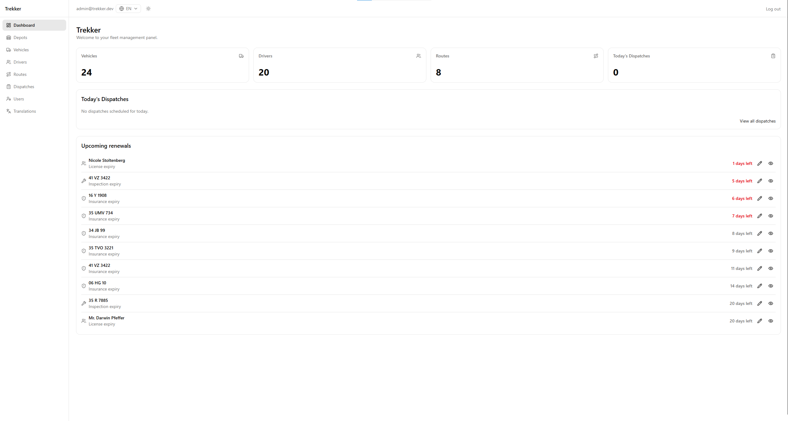
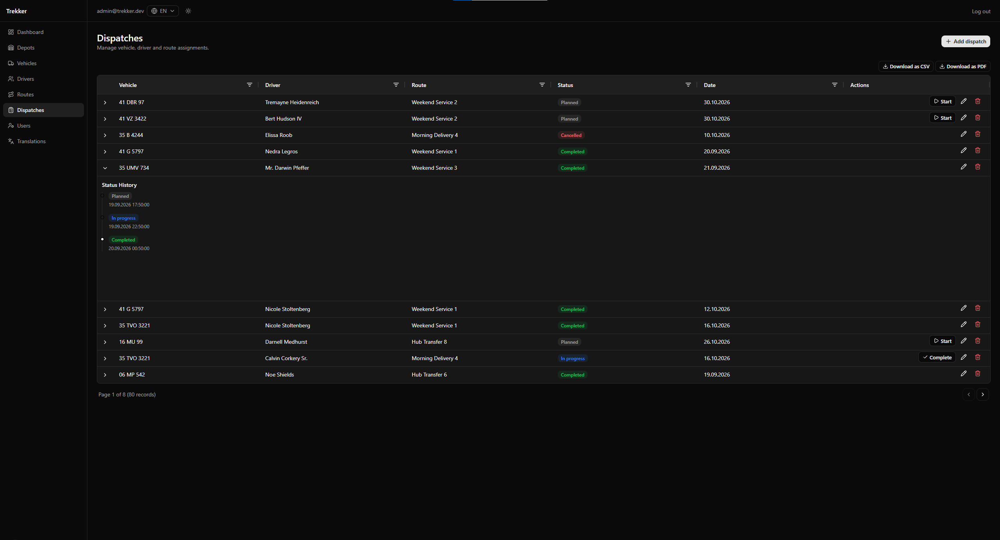
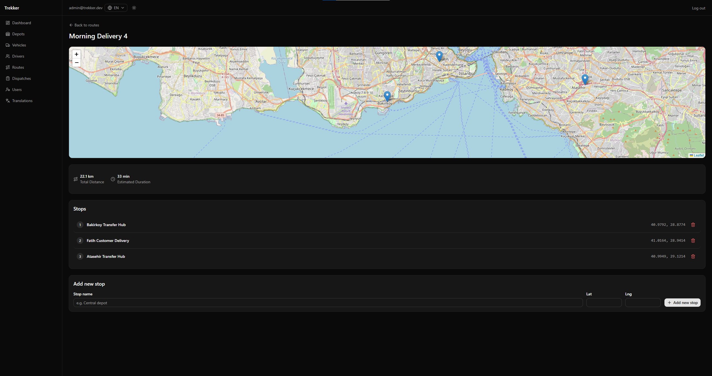
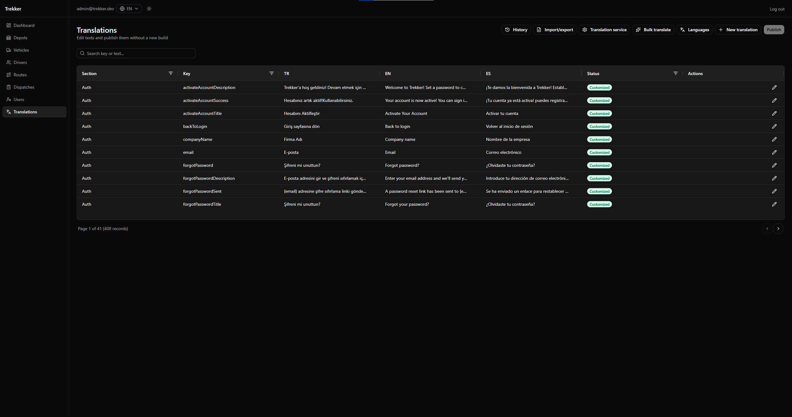
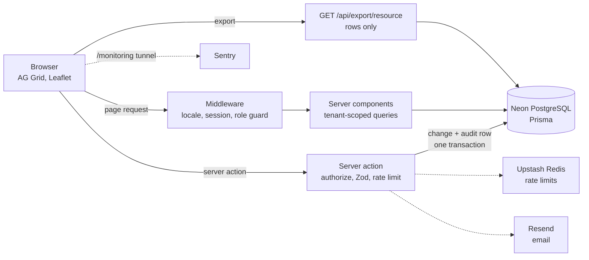

# Trekker

Multi-tenant fleet and dispatch management platform. Dispatchers plan routes, assign vehicles and drivers, and track dispatch status; drivers see and advance only their own work; administrators manage users and, at platform level, the application's texts without a redeploy.

> **Try the live demo (no sign-up):** https://trekker-gilt.vercel.app/en/login, then click **Try the live demo**.
> Every visitor gets a private, temporary tenant with sample data, deleted after 24 hours.

| Dashboard                                    | Dispatches grid                                |
| -------------------------------------------- | ---------------------------------------------- |
|  |  |

| Route map                                    | Audit log                                    |
| -------------------------------------------- | -------------------------------------------- |
|  |  |

| Translation panel                                  |
| -------------------------------------------------- |
|  |

## Highlights

- **Multi-tenant by design.** Every query is scoped by tenant, every server action is authorized, and ids from the client are never trusted (IDOR checks on all mutations).
- **Role-based access control in three layers:** middleware route protection, `authorize()` in every server action, and UI that only shows what a role can do. Roles: `ADMIN`, `DISPATCHER`, `DRIVER`.
- **Real token lifecycle.** Short-lived access token plus a database-backed, rotating refresh token. Changing a user's role revokes their refresh tokens and logs them out within seconds.
- **One generic data grid.** AG Grid is fully encapsulated behind a small `DataGrid` component: filters, sorting and pagination live in the URL and run on the server (Prisma), so every list page is shareable, bookmarkable and secure.
- **One export endpoint.** CSV and PDF export for every list, reusing the grid's own columns and the page's own query, so exports always match what the user sees and can never leak more than the page does.
- **Audit trail.** Every create, update, delete, status change, role change and invitation is recorded in the same database transaction as the change itself, so the log can never disagree with the data. Admins browse it in a filterable, exportable grid with a before/after diff per entry.
- **Tested tenant isolation.** An integration suite runs the real server actions against a separate database and asserts one invariant: nothing in tenant A changes when tenant B acts. 23 attack scenarios (cross-tenant ids on every mutation), read isolation and role checks run on every push.
- **Content management without a redeploy.** A platform-admin panel edits, validates, publishes and rolls back translations at runtime, and can machine-translate with a free service.
- **Internationalization.** Turkish and English out of the box, locale-prefixed URLs, languages that can be switched on from the panel.

## Features

### Operations

- Depots, vehicles, drivers, routes with ordered stops, and dispatches (full CRUD, pagination, filters).
- Route detail page with a Leaflet map, total distance (haversine) and an estimated duration.
- Dispatch status history: every change is recorded and shown as a timeline in the expandable row.
- One-click status advance (planned, in progress, completed) for drivers, dispatchers and admins. Drivers can only move their own dispatches forward; cancelling and reverting stay with managers.
- Dashboards per role: KPIs, upcoming insurance, inspection and licence renewals with quick edit, today's dispatches.

### Accounts and security

- Credentials login (bcrypt), self-service tenant registration, invitation by email (Resend), forgot and reset password with hashed, single-use, expiring tokens.
- No email enumeration on password reset; refresh tokens revoked on password change.
- Users screen (admin only) with invitations, role changes and a guard against deleting your own account.

### Audit log (admin)

- Append-only record of who changed what and when, for depots, vehicles, drivers, routes (including stops), dispatches (including status changes) and users (invitations, role changes, deletions).
- Each entry stores the actor, the action, a readable record label (plate, name) and a field-level diff (`from` / `to`). Depot, route, vehicle and driver names are stored instead of ids, and entries stay readable after the record or the user is deleted.
- Saving a form without changing anything writes nothing. Sensitive fields (password hashes, tokens) are excluded by a deny-list.
- Server-side filters (action, resource, user, record, date range), sorting and pagination, an expandable before/after panel per row, and CSV/PDF export through the shared export endpoint.

### Translation management (platform admin)

- Edit any text inline or in a dialog, per language, as **drafts**; publish all drafts at once and see the change immediately without a build.
- Add new keys from the panel; they are drafts too and follow the same rules.
- Enable languages from a fixed pool (`tr`, `en`, `de`, `fr`, `es`); a missing text shows its key name so gaps are easy to spot.
- Validation of ICU syntax and placeholders (`{name}`, tags) on save, on import and again at publish time.
- Release history with revert: undoing a release only touches texts that were not changed afterwards.
- JSON import and export, and optional machine translation (Gemini, Cloudflare Workers AI or MyMemory) with an optional automatic fallback to the next configured service.

## Tech stack

| Area          | Choice                                                                                |
| ------------- | ------------------------------------------------------------------------------------- |
| Framework     | Next.js 15 (App Router), React 19, TypeScript (strict)                                |
| Data          | PostgreSQL (Neon, pooled connection), Prisma 5                                        |
| Auth          | Auth.js v5 (credentials, JWT sessions), bcryptjs                                      |
| UI            | Tailwind CSS v4, shadcn/ui on Base UI primitives, lucide-react, sonner, next-themes   |
| Data grid     | AG Grid Community v36                                                                 |
| Maps          | Leaflet and react-leaflet                                                             |
| i18n          | next-intl                                                                             |
| Validation    | Zod 4, `@formatjs/icu-messageformat-parser`                                           |
| Email         | Resend                                                                                |
| Export        | jsPDF and jspdf-autotable (embedded DejaVu Sans for Turkish characters)               |
| Observability | Sentry                                                                                |
| Security      | Upstash Redis rate limiting, Content-Security-Policy and security headers, Dependabot |
| Tooling       | Vitest, GitHub Actions, ESLint 9 (flat config), Prettier, Husky and lint-staged       |

## Architecture notes



### Data grid

Pages never talk to AG Grid directly. They pass `GridColumn<T>[]` (header, raw value, renderer, filter type) to `DataGrid`, which wires filters, sorting and pagination to the URL. The server turns those URL params into a Prisma `where` / `orderBy` through generic builders, so adding a list page is a query file, a page and a column list.

### Exports

`GET /api/export/[resource]` accepts the same URL params as the page and returns rows only; CSV and PDF are produced in the browser from the grid's own columns. A registry maps each resource to a permission and a row fetcher, tenant always comes from the session, and CSV cells are protected against formula injection.

### Access control

`permissions.ts` is the single source of truth (resource and action per role). The middleware, `authorize()` and the UI all read from it. Drivers additionally get a row-level restriction (`driverId`) on every dispatch query.

### Audit log

`writeAudit()` takes the transaction client, so each server action writes the change and its log row in one `$transaction`: either both exist or neither does. Actions read the record first (scoped to the tenant, which also guards against IDOR), compute a diff with the pure, unit-tested `diffRecords()` and skip the log row when nothing changed. `actorEmail` and `resourceLabel` are stored as copies and `actorId` is `SET NULL` on user deletion, so history survives deletions. The `/audit-log` page is ADMIN-only (`auditLog: ["read"]` in `permissions.ts`), checked in the middleware and again on the page, and its query takes a required `tenantId` so a missing tenant can never widen the result.

### Translations

Messages ship as one flat JSON file (`localizations/translations.json`, `{ locale: { "Namespace.key": "text" } }`). At runtime the app merges published database overrides over that file and caches the result with `unstable_cache` and a tag; publishing calls `revalidateTag`, which is why no build is needed. Overrides can only replace existing keys or add valid new ones, and the flag that unlocks the panel (`isPlatformAdmin`) is read from the database on every action instead of the JWT.

## Live demo

The login page has a **Try the live demo** button. There is no shared account.

- **Isolated per visitor.** Each click creates a new tenant with seeded data (depots, vehicles, drivers,
  routes, dispatches, audit entries) and three users: Admin, Dispatcher and Driver. The banner lets you
  switch roles; the switch is validated on the server and can only reach users of the same demo tenant.
- **Disposable.** Demo tenants expire after 24 hours. An expired demo is rejected by the middleware,
  `authorize()`, session validation and token refresh, and is deleted in dependency order by a cleanup
  that runs after new demos are created, so no cron job is needed.
- **Abuse limits.** 3 demos per IP per hour (Upstash sliding window) and at most 50 active demo tenants.
- **Safe by construction.** Passwords are random and never shown. Demo sign-in uses a server-signed,
  60-second HMAC ticket instead of a password. Invites are simulated (unroutable `@demo.invalid`
  address, no email, no reset token), password reset is refused for demo accounts, the three seeded
  users cannot be edited or deleted, and `isPlatformAdmin` is never set. That is why the translation
  panel is not part of the demo; see the screenshots instead.
- **Tested.** Unit tests cover the ticket and email helpers. Integration tests cover tenant seeding,
  isolation between demos, and cleanup of expired demos.

## Security

- **Tenant isolation.** Every query and mutation is scoped by `tenantId` from the session, never from the client. Records are read tenant-scoped before they are changed (IDOR guard), and vehicle plates are unique per tenant (`@@unique([tenantId, plate])`), so one company can never see or block another's data.
- **Integration tests against a real database.** `tests/tenant-isolation.itest.ts` (32 tests) calls the real server actions on a dedicated Neon branch with a mocked session. Guards make sure a test cannot pass vacuously (for example by failing validation instead of reaching the tenant check). Run them with `npm run test:integration`.
- **Rate limiting.** Sliding-window limits (Upstash Redis) on login (per account and IP), forgot password, registration and password reset. They run inside `authorize()`, so the raw `/api/auth` endpoint is covered too. If Redis is unreachable the limiter fails open, so an outage cannot lock everyone out.
- **Authentication hardening.** Constant-time-ish login (a dummy bcrypt comparison for unknown emails), normalised emails, bounded input lengths, no email enumeration, hashed single-use tokens, refresh token rotation and revocation.
- **Headers and CSP.** `Content-Security-Policy` (no third-party scripts, no framing, restricted `connect-src` and `img-src`), `Strict-Transport-Security`, `X-Content-Type-Options`, `X-Frame-Options`, `Referrer-Policy` and `Permissions-Policy`. Map marker icons are self-hosted so the only external origin is the OpenStreetMap tile server.
- **Error reporting without leaks.** Sentry is configured not to collect request bodies or user info, because form posts contain passwords.
- **Supply chain.** CI runs `npm audit` (failing on critical), Dependabot opens weekly grouped updates, install scripts are allow-listed, and workflows do not persist git credentials.
- **Known gaps.** The CSP still allows `'unsafe-inline'` scripts and styles (Next.js inline payload, AG Grid runtime styles); a nonce-based policy is on the roadmap. Registration does not verify email addresses yet.

## Getting started

Requirements: Node.js 22.12 or newer and a PostgreSQL database (a free Neon project works).

```bash
git clone https://github.com/dogukanacet/trekker.git
cd trekker
npm install
cp .env.example .env   # then fill in the values below
npx prisma migrate dev
npm run dev
```

Open http://localhost:3000, register a company at `/register` (this creates a tenant, a depot and an `ADMIN` user), then explore.

### Environment variables

| Variable                                             | Required  | Purpose                                                   |
| ---------------------------------------------------- | --------- | --------------------------------------------------------- |
| `DATABASE_URL`                                       | yes       | PostgreSQL connection string (use the pooled one on Neon) |
| `AUTH_SECRET`                                        | yes       | Auth.js secret (`npx auth secret`)                        |
| `AUTH_URL`                                           | yes       | Base URL of the app, also used in email links             |
| `ACCESS_TOKEN_EXPIRE_MS`                             | yes       | Access token lifetime (for example `1800000`)             |
| `REFRESH_TOKEN_EXPIRE_MS`                            | yes       | Refresh token lifetime                                    |
| `UPSTASH_REDIS_REST_URL`, `UPSTASH_REDIS_REST_TOKEN` | no        | Rate limiting (without them limits are skipped)           |
| `RESEND_API_KEY`                                     | for email | Invitation and password reset emails                      |
| `GEMINI_API_KEY`, `GEMINI_MODEL`                     | no        | Machine translation with Gemini                           |
| `CLOUDFLARE_ACCOUNT_ID`, `CLOUDFLARE_API_TOKEN`      | no        | Machine translation with Cloudflare Workers AI            |
| `MYMEMORY_EMAIL`                                     | no        | Raises the MyMemory free daily limit                      |
| `TRANSLATION_PROVIDER`                               | no        | Force `gemini`, `cloudflare` or `mymemory` as the default |

Sentry variables are only needed if you want error reporting.

### Becoming a platform admin

The translation panel is not reachable through any role. Set the flag yourself, for example in Prisma Studio (`npx prisma studio`): `User.isPlatformAdmin = true`. It is intentionally not editable from the UI.

### Running the integration tests

Create a separate database (a Neon branch works), put `DATABASE_URL="..."` and `INTEGRATION_TEST_DB=1` in `.env.test`, then run `npm run test:db:migrate` followed by `npm run test:integration`. The setup refuses to run without the flag, so the suite can never touch a real database by accident. CI does the same with a repository secret.

### Demo data

`npm run mock:seed` adds realistic depots, vehicles, drivers, routes, dispatches (with consistent status history) and expiring documents to an existing tenant. Passwords of the generated dispatcher and driver accounts are printed once in the terminal. `npm run mock:clean` removes only what the script created.

```bash
npm run mock:seed -- --email you@example.com
```

## Scripts

| Script                                            | What it does                                                                                   |
| ------------------------------------------------- | ---------------------------------------------------------------------------------------------- |
| `npm run dev` / `build` / `start`                 | Next.js development, production build (runs `prisma generate` and `migrate deploy`) and server |
| `npm test`                                        | Unit tests (Vitest)                                                                            |
| `npm run test:integration`                        | Tenant isolation tests against a dedicated test database (`.env.test`, see below)              |
| `npm run lint` / `format`                         | ESLint and Prettier                                                                            |
| `npm run mock:seed` / `mock:clean` / `mock:reset` | Demo data                                                                                      |
| `npm run i18n:merge`                              | One-off helper that merged the old per-locale JSON files into one                              |

## Project structure

```
src/
  app/[locale]/(auth)/        login, register, password flows
  app/[locale]/(dashboard)/   dashboard and one folder per resource
                              (query.ts, page.tsx, Grid, actions.ts, dialogs)
  app/[locale]/(dashboard)/translations/   translation panel
  app/[locale]/(dashboard)/audit-log/      audit log grid, query and diff panel
  app/api/                    auth, export
  components/data-grid/       the AG Grid wrapper
  lib/                        auth, permissions, export, pagination, query builders
  lib/translations/           catalog, validation, import/export, providers
  lib/audit/                  diffRecords (pure, tested) and writeAudit (transaction-aware)
  i18n/                       routing, request config, message loading
localizations/translations.json
tests/                       integration tests (tenant isolation)
.github/                     CI workflow and Dependabot
prisma/schema.prisma
scripts/mock-data.ts
```

## Known limitations and decisions

- **"Today" uses the server time zone.** On Vercel that is UTC, so between 00:00 and 03:00 in Istanbul the day boundary is off. A per-tenant time zone is the proper fix.
- **Export is capped at 5,000 rows** and silently truncated beyond that.
- **Translation panel scope.** A key added from the panel only appears where the code references it. Languages outside the fixed pool need a deploy. Machine translations are drafts of unknown quality, so they are never published automatically.
- **Audit log scope.** Only changes made through the app's server actions are recorded: data written by `mock:seed` is not, sign-in events are not logged yet, and there is no retention policy (the table only grows). Translation changes keep their own release history instead of being duplicated here.
- **No browser-level tests.** Pure logic is unit tested and tenant isolation is covered by database integration tests; browser end-to-end tests were deliberately left out.
- **Email sender.** Until a domain is verified in Resend, mail can only be delivered to the account owner's address.

## Roadmap

- Per-tenant time zone and a date rule for starting future dispatches.
- Deactivating users instead of deleting them.
- Sign-in events and a retention policy for the audit log.
- Scheduled reports (needs the export columns on the server).
- Nonce-based CSP, email verification on registration.
- Browser-level end-to-end tests.
