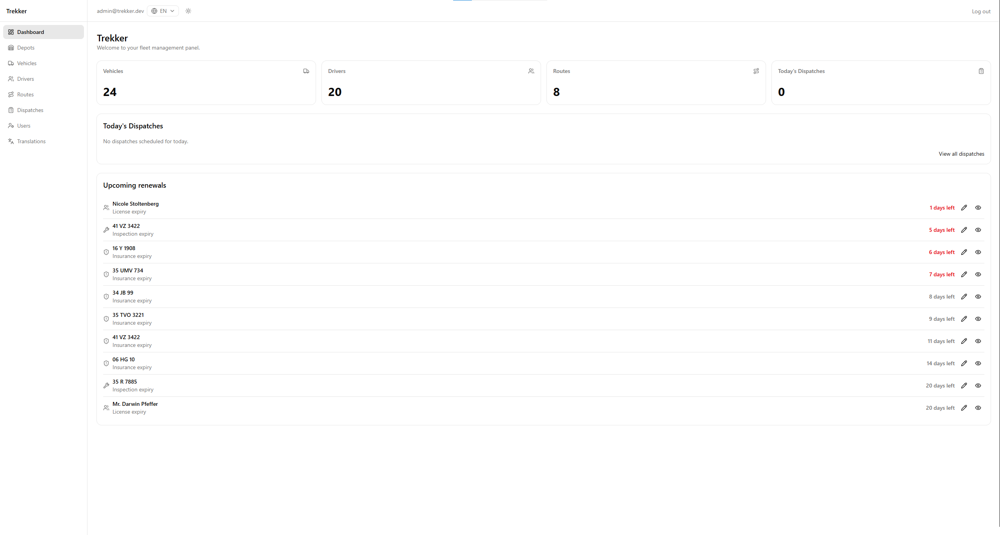
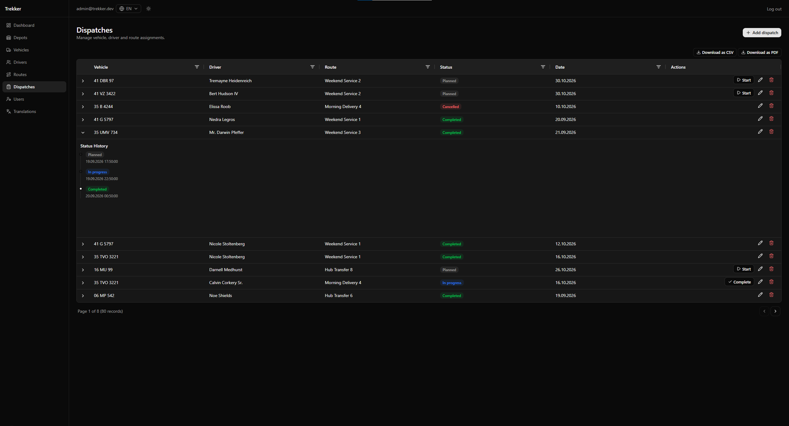
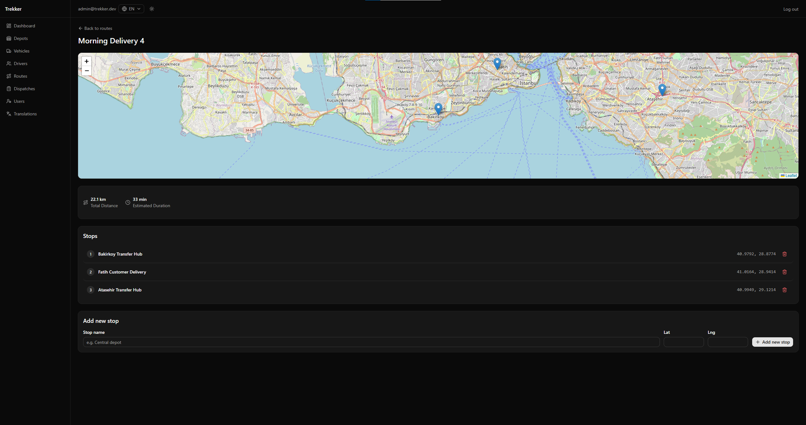
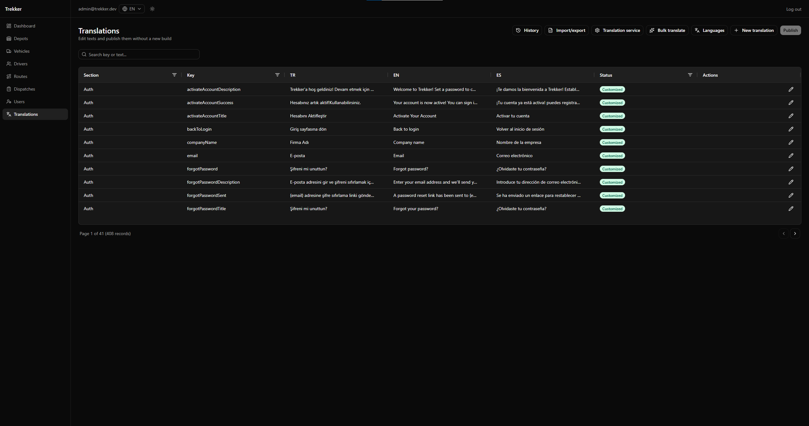

# Trekker

Multi-tenant fleet and dispatch management platform. Dispatchers plan routes, assign vehicles and drivers, and track dispatch status; drivers see and advance only their own work; administrators manage users and, at platform level, the application's texts without a redeploy.

**Live demo:** https://trekker-gilt.vercel.app

> Screenshots: replace the placeholders below with images from `docs/screenshots/`.

| Dashboard                                    | Dispatches grid                                |
| -------------------------------------------- | ---------------------------------------------- |
|  |  |

| Route map                                    | Translation panel                                  |
| -------------------------------------------- | -------------------------------------------------- |
|  |  |

## Highlights

- **Multi-tenant by design.** Every query is scoped by tenant, every server action is authorized, and ids from the client are never trusted (IDOR checks on all mutations).
- **Role-based access control in three layers:** middleware route protection, `authorize()` in every server action, and UI that only shows what a role can do. Roles: `ADMIN`, `DISPATCHER`, `DRIVER`.
- **Real token lifecycle.** Short-lived access token plus a database-backed, rotating refresh token. Changing a user's role revokes their refresh tokens and logs them out within seconds.
- **One generic data grid.** AG Grid is fully encapsulated behind a small `DataGrid` component: filters, sorting and pagination live in the URL and run on the server (Prisma), so every list page is shareable, bookmarkable and secure.
- **One export endpoint.** CSV and PDF export for every list, reusing the grid's own columns and the page's own query, so exports always match what the user sees and can never leak more than the page does.
- **Content management without a redeploy.** A platform-admin panel edits, validates, publishes and rolls back translations at runtime, and can machine-translate with a free service.
- **Internationalization.** Turkish and English out of the box, locale-prefixed URLs, languages that can be switched on from the panel.

## Features

### Operations

- Depots, vehicles, drivers, routes with ordered stops, and dispatches (full CRUD, pagination, filters).
- Route detail page with a Leaflet map, total distance (haversine) and an estimated duration.
- Dispatch status history: every change is recorded and shown as a timeline in the expandable row.
- One-click status advance (planned, in progress, completed) for drivers, dispatchers and admins. Drivers can only move their own dispatches forward; cancelling and reverting stay with managers.
- Dashboards per role: KPIs, upcoming insurance, inspection and licence renewals with quick edit, today's dispatches.

### Accounts and security

- Credentials login (bcrypt), self-service tenant registration, invitation by email (Resend), forgot and reset password with hashed, single-use, expiring tokens.
- No email enumeration on password reset; refresh tokens revoked on password change.
- Users screen (admin only) with invitations, role changes and a guard against deleting your own account.

### Translation management (platform admin)

- Edit any text inline or in a dialog, per language, as **drafts**; publish all drafts at once and see the change immediately without a build.
- Add new keys from the panel; they are drafts too and follow the same rules.
- Enable languages from a fixed pool (`tr`, `en`, `de`, `fr`, `es`); a missing text shows its key name so gaps are easy to spot.
- Validation of ICU syntax and placeholders (`{name}`, tags) on save, on import and again at publish time.
- Release history with revert: undoing a release only touches texts that were not changed afterwards.
- JSON import and export, and optional machine translation (Gemini, Cloudflare Workers AI or MyMemory) with an optional automatic fallback to the next configured service.

## Tech stack

| Area          | Choice                                                                              |
| ------------- | ----------------------------------------------------------------------------------- |
| Framework     | Next.js 15 (App Router), React 19, TypeScript (strict)                              |
| Data          | PostgreSQL (Neon, pooled connection), Prisma 5                                      |
| Auth          | Auth.js v5 (credentials, JWT sessions), bcryptjs                                    |
| UI            | Tailwind CSS v4, shadcn/ui on Base UI primitives, lucide-react, sonner, next-themes |
| Data grid     | AG Grid Community v36                                                               |
| Maps          | Leaflet and react-leaflet                                                           |
| i18n          | next-intl                                                                           |
| Validation    | Zod, `@formatjs/icu-messageformat-parser`                                           |
| Email         | Resend                                                                              |
| Export        | jsPDF and jspdf-autotable (embedded DejaVu Sans for Turkish characters)             |
| Observability | Sentry                                                                              |
| Tooling       | Vitest, ESLint 9 (flat config), Prettier, Husky and lint-staged                     |

## Architecture notes

### Data grid

Pages never talk to AG Grid directly. They pass `GridColumn<T>[]` (header, raw value, renderer, filter type) to `DataGrid`, which wires filters, sorting and pagination to the URL. The server turns those URL params into a Prisma `where` / `orderBy` through generic builders, so adding a list page is a query file, a page and a column list.

### Exports

`GET /api/export/[resource]` accepts the same URL params as the page and returns rows only; CSV and PDF are produced in the browser from the grid's own columns. A registry maps each resource to a permission and a row fetcher, tenant always comes from the session, and CSV cells are protected against formula injection.

### Access control

`permissions.ts` is the single source of truth (resource and action per role). The middleware, `authorize()` and the UI all read from it. Drivers additionally get a row-level restriction (`driverId`) on every dispatch query.

### Translations

Messages ship as one flat JSON file (`localizations/translations.json`, `{ locale: { "Namespace.key": "text" } }`). At runtime the app merges published database overrides over that file and caches the result with `unstable_cache` and a tag; publishing calls `revalidateTag`, which is why no build is needed. Overrides can only replace existing keys or add valid new ones, and the flag that unlocks the panel (`isPlatformAdmin`) is read from the database on every action instead of the JWT.

## Getting started

Requirements: Node.js 20.6 or newer and a PostgreSQL database (a free Neon project works).

```bash
git clone https://github.com/dogukanacet/trekker
cd trekker
npm install
cp .env.example .env   # then fill in the values below
npx prisma migrate dev
npm run dev
```

Open http://localhost:3000, register a company at `/register` (this creates a tenant, a depot and an `ADMIN` user), then explore.

### Environment variables

| Variable                                        | Required  | Purpose                                                   |
| ----------------------------------------------- | --------- | --------------------------------------------------------- |
| `DATABASE_URL`                                  | yes       | PostgreSQL connection string (use the pooled one on Neon) |
| `AUTH_SECRET`                                   | yes       | Auth.js secret (`npx auth secret`)                        |
| `AUTH_URL`                                      | yes       | Base URL of the app, also used in email links             |
| `ACCESS_TOKEN_EXPIRE_MS`                        | yes       | Access token lifetime (for example `1800000`)             |
| `REFRESH_TOKEN_EXPIRE_MS`                       | yes       | Refresh token lifetime                                    |
| `RESEND_API_KEY`                                | for email | Invitation and password reset emails                      |
| `GEMINI_API_KEY`, `GEMINI_MODEL`                | no        | Machine translation with Gemini                           |
| `CLOUDFLARE_ACCOUNT_ID`, `CLOUDFLARE_API_TOKEN` | no        | Machine translation with Cloudflare Workers AI            |
| `MYMEMORY_EMAIL`                                | no        | Raises the MyMemory free daily limit                      |
| `TRANSLATION_PROVIDER`                          | no        | Force `gemini`, `cloudflare` or `mymemory` as the default |

Sentry variables are only needed if you want error reporting.

### Becoming a platform admin

The translation panel is not reachable through any role. Set the flag yourself, for example in Prisma Studio (`npx prisma studio`): `User.isPlatformAdmin = true`. It is intentionally not editable from the UI.

### Demo data

`npm run mock:seed` adds realistic depots, vehicles, drivers, routes, dispatches (with consistent status history) and expiring documents to an existing tenant. Passwords of the generated dispatcher and driver accounts are printed once in the terminal. `npm run mock:clean` removes only what the script created.

```bash
npm run mock:seed -- --email you@example.com
```

## Scripts

| Script                                            | What it does                                                                                   |
| ------------------------------------------------- | ---------------------------------------------------------------------------------------------- |
| `npm run dev` / `build` / `start`                 | Next.js development, production build (runs `prisma generate` and `migrate deploy`) and server |
| `npm test`                                        | Unit tests (Vitest)                                                                            |
| `npm run lint` / `format`                         | ESLint and Prettier                                                                            |
| `npm run mock:seed` / `mock:clean` / `mock:reset` | Demo data                                                                                      |
| `npm run i18n:merge`                              | One-off helper that merged the old per-locale JSON files into one                              |

## Project structure

```
src/
  app/[locale]/(auth)/        login, register, password flows
  app/[locale]/(dashboard)/   dashboard and one folder per resource
                              (query.ts, page.tsx, Grid, actions.ts, dialogs)
  app/[locale]/(dashboard)/translations/   translation panel
  app/api/                    auth, export
  components/data-grid/       the AG Grid wrapper
  lib/                        auth, permissions, export, pagination, query builders
  lib/translations/           catalog, validation, import/export, providers
  i18n/                       routing, request config, message loading
localizations/translations.json
prisma/schema.prisma
scripts/mock-data.ts
```

## Known limitations and decisions

- **"Today" uses the server time zone.** On Vercel that is UTC, so between 00:00 and 03:00 in Istanbul the day boundary is off. A per-tenant time zone is the proper fix.
- **Export is capped at 5,000 rows** and silently truncated beyond that.
- **Translation panel scope.** A key added from the panel only appears where the code references it. Languages outside the fixed pool need a deploy. Machine translations are drafts of unknown quality, so they are never published automatically.
- **No end-to-end tests.** Pure logic (validation, import analysis, revert planning, query building) is unit tested; browser-level tests were deliberately left out.
- **Email sender.** Until a domain is verified in Resend, mail can only be delivered to the account owner's address.

## Roadmap

- Per-tenant time zone and a date rule for starting future dispatches.
- Deactivating users instead of deleting them.
- Scheduled reports (needs the export columns on the server).
- Browser-level end-to-end tests.
